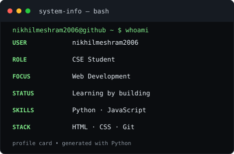

<div align="center">

# `nikhilmeshram2006@github:~`

**CSE STUDENT · WEB DEVELOPER IN PROGRESS**


</div>

## `$ ./contributions.sh`
<p align="center"></p>

## `$ whoami`
<p align="center">
  
  
</p>

```text
USER       nikhilmeshram2006
ROLE       CSE student
FOCUS      Web development
LANGUAGES  Python · JavaScript · HTML · CSS
STATUS     Learning by building
```

## `$ ls projects/`
- Building and improving web projects.
- Practising Python automation and programming fundamentals.
- Learning modern web development.

---
<sub>Generated with Python · SVG artwork · GitHub Actions</sub>

**Note:** The portrait is a placeholder until you replace it with your own photo. The initial contribution graph uses placeholder data; run the workflow to fetch public contribution data.
