"nikhilmeshram2006@github:~"

CSE Student · Developer

I enjoy building things, experimenting with new ideas, and learning how software works.

Currently exploring web development, Python, and software engineering.

"$ whoami"

- Computer Science student
- Interested in web development and software development
- Learning by building personal projects

"$ technologies"

- Languages: Python, JavaScript, HTML, CSS
- Exploring: React, Kotlin

"$ projects"

A selection of things I've built:

Project| Description
"Nothing File Manager" (https://github.com/nikhilmeshram2006/Nothing-file-manager)| A minimal file manager inspired by Nothing OS
"F1 Telemetry Analyzer" (https://github.com/nikhilmeshram2006/f1-telemetry-analyzer)| Formula 1 telemetry comparison and visualization
"Personal Portfolio" (https://github.com/nikhilmeshram2006/nikhilmeshram2006.github.io)| My personal website
"Calculator" (https://github.com/nikhilmeshram2006/calculator-with-separate-history-page)| Calculator with history and keyboard support
"Shorekeeper Store" (https://github.com/nikhilmeshram2006/shorekeeper-store)| A clothing e-commerce website

"$ github-activity"

  

---

Learning by building, one project at a time.
